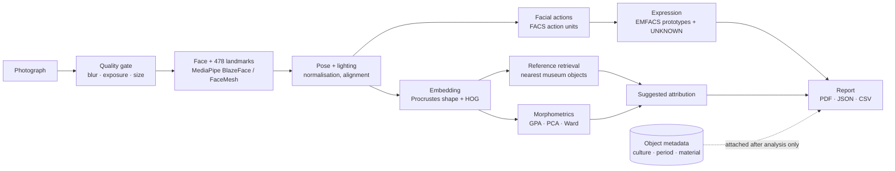

# Sculpture Face Analysis

**Computational analysis of facial expression and facial morphology in sculpture and art — from Moche portrait vessels to faces from every culture.**

[](https://github.com/Tiakat/sculpture-face-analysis/actions/workflows/tests.yml)


<sub>Moche portrait-head bottle, Peru, The Metropolitan Museum of Art (CC0). All figures in this README were produced by the software in this repository.</sub>

Upload a photograph of a sculpture. The platform finds the face, places 478 landmarks, corrects pose and lighting, reads the **implied facial actions** (FACS, Paul Ekman), estimates the **depicted expression** with probabilities and an explicit *UNKNOWN*, compares the face with a reference database of museum objects, runs **geometric morphometrics** (Procrustes / PCA, after Millones' *Vasijas-Retrato Moche*), and proposes where the object most resembles — then writes a PDF / JSON / CSV report.

Two desktop applications share one analysis core:

| | **Moche Face Platform** | **Global Face Heritage Platform** |
|---|---|---|
| Scope | Moche (ancient Peru) portrait vessels | Any culture, period, material and medium — sculpture, painting, drawing, print, photograph |
| Reference data | Met, Cleveland, Art Institute of Chicago, Wikimedia, Brooklyn, Harvard, Smithsonian, Europeana | Same sources + Rijksmuseum, Getty — with a controlled taxonomy of 70+ cultures |
| Suggests | Valley · phase · date range | Culture · region · period · material |
| Folder | [`moche-face-platform/`](moche-face-platform) | [`global-face-platform/`](global-face-platform) |

---

## How it works



The dotted line is the **metadata firewall**: culture, period or material are never an input to the face computation (enforced in code and tested), so a suggestion can never be circular.

A plain-language explanation of every technique, how it is used and what to read is in **[docs/TECHNIQUES.md](docs/TECHNIQUES.md)**.

---

## Results

### Facial actions and the muscles associated with them
A sculpture has no muscles, so the platform reports an *implied facial-action configuration*: the geometry of the carved face compared with a neutral template. Colour = action unit, thickness = evidence.


| Depicted expression (probabilities, not a single verdict) | Action units and the geometry behind them |
|---|---|
|  |  |

### Geometric morphometrics (after Millones)
(a) 33 anthropometric landmarks, (b) Procrustes superimposition against the reference consensus, (c) principal components of shape with 95 % ellipses per group — the star is the analysed face.


### Comparison with the reference database
Nearest objects overall, with the same expression, and from the same group — each with museum, date, licence and link to the source.


### Suggested attribution on a face the system had never seen
Marble head of Demosthenes (Roman copy, The Met, CC0), analysed against a small open-access reference set of 94 faces (16 cultures):


Honest counter-example from the same run: a Ptolemaic head of Ptolemy III (Egypt, Greek-style) was suggested as *Roman Imperial / Mediterranean* at 47 % — its Hellenistic style sits closer to the Roman portraits than to the Egyptian ones in such a small reference set. This is why the output is labelled a **suggestion**, shows its alternatives, and improves as the reference database grows.

### Robustness
The same face is re-analysed under five lighting normalisations and six small geometric perturbations; the report says whether the label is stable.


### The application

| Analysis report | Reference database (persistent, built once) |
|---|---|
|  |  |
| **Upload + object record** | **Administrator view** |
|  |  |

---

## Features

- **Analysis**: quality gate · multi-face detection · stylised-face fallback and manual face rectangle · pose · illumination normalisation · 15 FACS-inspired action units · expression with probabilities, confidence and UNKNOWN · stability tests · difficulty level 0–6 per face.
- **Comparison**: appearance + shape embedding · three comparison grids · Procrustes / PCA / Ward morphometrics · morphological affinity by group · suggested attribution with alternatives and supporting specimens.
- **Data**: connectors to nine open-access museum APIs · licence-aware storage (CC0 / public domain / CC BY only) · duplicate detection (SHA-256 + perceptual hash) · controlled taxonomy · leakage-safe train/test splits by object, mould, institution or culture.
- **Platform**: FastAPI + SQLite · registration and login (bcrypt, JWT) · researcher / admin roles · each researcher sees only their own analyses · rate limiting and lock-out · audit log · security headers · password reset · expert validation and flagging · versioned, reproducible reports.
- **Desktop**: one double-click installer for Windows that brings its own private Python runtime and puts an icon on the Desktop.

## Quick start

**Windows (no programming needed)** — open the app folder and double-click `Repair - <app name>.bat` once. It downloads a private Python runtime and the libraries, then puts an icon on the Desktop.

**Developer mode (any OS, Python 3.10–3.12)**

```bash
cd global-face-platform            # or moche-face-platform
python -m venv .venv && source .venv/bin/activate      # .venv\Scripts\activate on Windows
pip install -r requirements.txt
uvicorn app.main:app --port 8000   # open http://localhost:8000   (API docs at /docs)
```

The first account registered becomes the administrator (or set `GFP_ADMIN_EMAILS` / `MFP_ADMIN_EMAILS`). Build the reference database from the **Reference** page, or from the command line:

```bash
python scripts/ingest.py met cleveland wikimedia --limit 200     # Global
python scripts/build_reference_index.py
```

**Tests** — `python -m pytest -q tests` in each app folder (36 tests; run automatically on every push).

## Project layout

```
moche-face-platform/ · global-face-platform/
├── app/
│   ├── pipeline/   quality · landmarks · pose · normalization · action_units · expression
│   │               embedding · reference_index · morphometrics · visuals · report · runner
│   ├── routers/    auth · analyses / objects · references · admin
│   └── static/     single-page web interface
├── scripts/        museum connectors, corpus import, reference-index builder
├── training/       leakage-safe splits, evaluation, optional classifier training, neutral-template calibration
├── config/         neutral template, taxonomy (Global)
├── docs/           specification, scientific notes, datasets, literature, security
└── tests/          API and pipeline tests
```

## Scientific stance

- The platform reports the **depicted** expression of an artwork, never the emotion of a historical person (Barrett et al. 2019).
- Action units are an **implied configuration** inferred from carved or painted geometry.
- Morphometric results are **affinity to a reference sample**, never geographic origin.
- The expression model is a **frozen, documented** prototype classifier (EMFACS). No labelled sculpture dataset exists yet; the platform is built to collect expert annotations so a model can be trained and evaluated properly later.

## Key references

- Cowen, A. S. & Keltner, D. (2020). Universal facial expressions uncovered in art of the ancient Americas. *Science Advances* 6(34).
- Millones, M. *Vasijas-Retrato Moche: Ordenando Rostros (Forma, Tiempo y Espacio).*
- Ekman, P., Friesen, W. V. & Hager, J. C. (2002). *Facial Action Coding System.*
- Barrett, L. F. et al. (2019). Emotional expressions reconsidered. *Psychological Science in the Public Interest* 20(1).
- Rohlf, F. J. & Slice, D. E. (1990). Extensions of the Procrustes method. *Systematic Zoology* 39.
- Kartynnik, Y. et al. (2019). Real-time facial surface geometry from monocular video (MediaPipe FaceMesh). *CVPR Workshops.*

Full list: [docs/TECHNIQUES.md](docs/TECHNIQUES.md) · [moche-face-platform/docs/LITERATURE.md](moche-face-platform/docs/LITERATURE.md)

## Image credits

Every photograph in `docs/figures` comes from museum open-access programmes and is in the public domain (CC0):
[Bottle with portrait head, Moche — The Met 308528](https://www.metmuseum.org/art/collection/search/308528) ·
[Marble head of Demosthenes — The Met 257882](https://www.metmuseum.org/art/collection/search/257882) ·
comparison thumbnails from [The Met Open Access](https://www.metmuseum.org/about-the-met/policies-and-documents/open-access) and [Cleveland Museum of Art Open Access](https://www.clevelandart.org/open-access).
No museum images are stored in this repository beyond these figures; the reference databases are downloaded by each user.

## Author

**Katia Djerroud** — research software for computational art history and affective science.
Released under the [MIT License](LICENSE).
